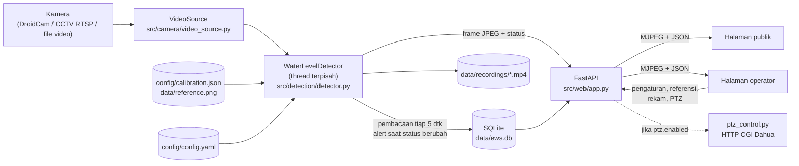
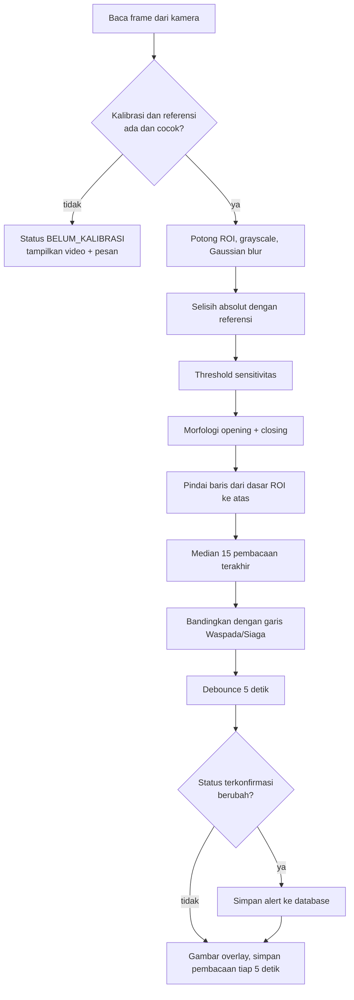
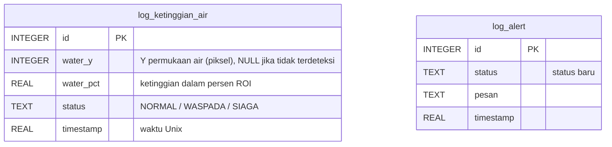

# 2. Arsitektur Sistem

## 2.1 Diagram komponen

Sistem terdiri dari dua bagian yang berjalan dalam satu proses Python:

1. **Thread detektor**: membaca kamera terus-menerus, memproses frame (maksimal 15 frame/detik),
   menghitung status, lalu menyimpan hasil ke database dan menyiapkan frame untuk ditampilkan.
2. **Server web (FastAPI + Uvicorn)**: melayani halaman, stream video, dan API. Server hanya
   *membaca* hasil terbaru dari detektor, sehingga jumlah penonton tidak memperlambat deteksi.

## 2.2 Alur pemrosesan satu frame

Jika kamera gagal dibaca 5 kali berturut-turut, status menjadi **OFFLINE**, alert "Kamera terputus"
dicatat, dan detektor mencoba menyambung ulang setiap 2 detik.

## 2.3 Status sistem

| Status | Arti | Tampilan |
|---|---|---|
| NORMAL | Air di bawah garis Waspada atau tidak terdeteksi | Hijau |
| WASPADA | Air melewati garis kuning | Kuning |
| SIAGA | Air melewati garis merah | Merah berkedip |
| OFFLINE | Kamera tidak terhubung | Abu-abu |
| BELUM_KALIBRASI | Kalibrasi/referensi belum ada, atau resolusi kamera berubah | Abu-abu + pesan |

OFFLINE dan BELUM_KALIBRASI sengaja dibedakan dari NORMAL agar kegagalan sistem tidak
disalahartikan sebagai kondisi aman.

## 2.4 Modul

| File | Tanggung jawab |
|---|---|
| `src/config.py` | Membaca `config/config.yaml`, nilai default, lokasi file |
| `src/camera/video_source.py` | Membuka webcam (DirectShow, cadangan Media Foundation), URL (RTSP/HTTP dengan timeout), atau file video (diputar berulang sesuai FPS) |
| `src/camera/ptz_control.py` | Kontrol PTZ Dahua: baca posisi, pindah ke posisi tersimpan, koreksi *closed-loop* |
| `src/detection/water_level.py` | Fungsi inti CV: praproses, mask perubahan, pemindaian dari dasar, status, persentase |
| `src/detection/debounce.py` | Penyaring status berbasis waktu |
| `src/detection/calibration.py` | Simpan/muat ROI, garis batas, resolusi, gambar referensi; validasi kalibrasi |
| `src/detection/recorder.py` | Perekam video asli dan video hasil deteksi |
| `src/detection/detector.py` | Pipeline lengkap dalam thread, status publik, frame untuk stream |
| `src/web/app.py` | Endpoint halaman dan API |
| `src/web/database.py` | Tabel pembacaan dan alert (SQLite, mode WAL) |
| `src/web/auth.py` | Login operator dengan sesi cookie (berlaku 8 jam) |
| `scripts/kalibrasi.py` | Kalibrasi interaktif dari kamera |
| `scripts/cek_kamera.py` | Menampilkan semua webcam beserta nomornya |
| `scripts/main_detector.py` | Mode jendela: hasil dan mask berdampingan, slider pengaturan |
| `scripts/gambar_tahapan.py` | Gambar tiap tahap metode untuk dokumentasi |

## 2.5 API

| Metode | Endpoint | Akses | Fungsi |
|---|---|---|---|
| GET | `/` | Publik | Halaman publik |
| GET | `/login`, POST `/login`, GET `/logout` | Publik | Autentikasi operator |
| GET | `/operator` | Operator | Halaman operator |
| GET | `/video_feed?view=annotated\|mask` | Publik | Stream MJPEG |
| GET | `/api/status` | Publik | Status, persentase air, status kamera, status rekaman |
| GET | `/api/history?minutes=N` | Publik | Riwayat pembacaan |
| GET | `/api/alerts?hours=N` | Publik | Riwayat alert |
| GET | `/api/settings` | Publik | Sensitivitas dan blur saat ini |
| POST | `/api/settings` | Operator | Ubah sensitivitas/blur |
| POST | `/api/reference` | Operator | Jadikan frame saat ini sebagai referensi |
| POST | `/api/recording` | Operator | Mulai/berhenti merekam |
| POST | `/api/ptz/reset` | Operator | Kembalikan kamera PTZ ke posisi papan duga |

## 2.6 Database

Pembacaan disimpan setiap 5 detik. Alert disimpan hanya saat status terkonfirmasi berubah atau
kamera terputus. `water_pct` disimpan langsung agar riwayat tetap benar walaupun ROI dikalibrasi
ulang di kemudian hari.

## 2.7 Teknologi

| Bagian | Teknologi |
|---|---|
| Bahasa | Python 3.14 |
| Pengolahan citra | OpenCV 5.0, NumPy |
| Web server | FastAPI, Uvicorn, Jinja2 |
| Database | SQLite |
| Antarmuka | HTML, CSS, JavaScript, Chart.js |
| Kamera | DroidCam (USB) / RTSP / Dahua HTTP CGI |
| Pengujian | pytest |
