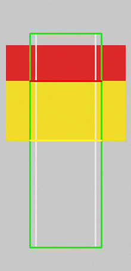
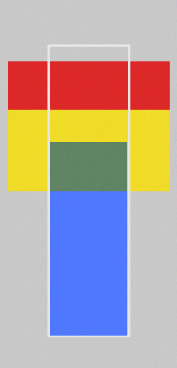
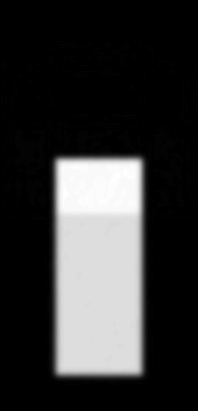
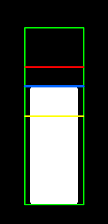
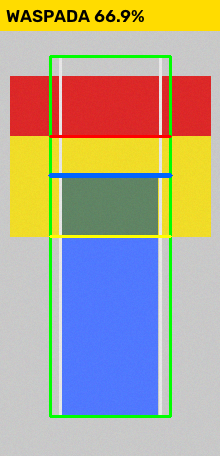
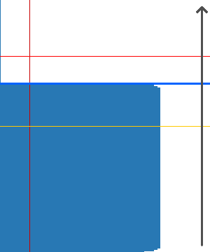
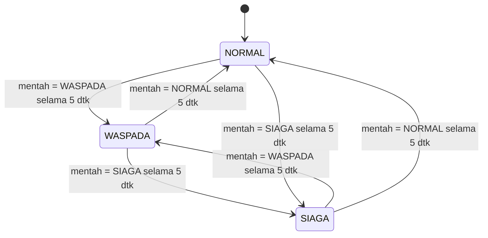

# 3. Metode Deteksi: Bottom-Up Frame Differencing

Metode ini membandingkan setiap frame kamera dengan **gambar referensi** kondisi normal (air
rendah / botol kosong). Bagian yang berubah dianggap air. Permukaan air kemudian dicari dengan
memindai area pantau **dari dasar ke atas**, karena air selalu naik dari bawah.

Gambar di bawah adalah ilustrasi dari adegan sintetis (dibuat oleh `scripts/gambar_tahapan.py --sintetis`).
Kotak hijau = ROI, garis kuning = batas Waspada, garis merah = batas Siaga, garis biru = permukaan
air terdeteksi.

| Referensi | Frame | Selisih | Threshold | Morfologi | Hasil |
|---|---|---|---|---|---|
|  |  |  |  |  |  |

## 3.1 Kalibrasi (dilakukan sekali)

1. **Gambar referensi** *R*: satu frame saat air rendah / botol kosong, disimpan lossless (PNG).
2. **ROI** (*Region of Interest*): kotak `(x, y, w, h)` yang menutupi papan duga / botol, dimulai
   tepat dari dasarnya. Semua pemrosesan hanya dilakukan di dalam ROI.
3. **Garis batas**: dua koordinat Y, `y_waspada` (kuning) dan `y_siaga` (merah). Karena sumbu Y
   gambar mengarah ke bawah, garis yang lebih tinggi memiliki Y lebih kecil, sehingga
   `y_siaga < y_waspada`.
4. **Resolusi frame** saat kalibrasi. Jika resolusi kamera berubah, kalibrasi dinyatakan tidak berlaku.

## 3.2 Tahapan per frame

### Tahap 1: Praproses

Frame *F* dan referensi *R* dipotong sesuai ROI, diubah ke grayscale, lalu dihaluskan dengan
Gaussian blur berukuran *k × k* (default *k* = 21):

```
Gray = 0,299·R + 0,587·G + 0,114·B
F' = GaussianBlur(Gray(F), k)        R' = GaussianBlur(Gray(R), k)
```

Blur meredam noise sensor kamera dan perbedaan kecil antar-frame agar tidak terbaca sebagai perubahan.
Referensi diblur dengan ukuran kernel yang sama dengan frame, sehingga perubahan slider blur di
dashboard tidak menimbulkan selisih palsu.

### Tahap 2: Selisih absolut (*frame differencing*)

```
D(x, y) = | R'(x, y) − F'(x, y) |
```

Nilai *D* besar berarti piksel tersebut berubah dibanding kondisi normal.

### Tahap 3: Threshold

```
M(x, y) = 255  jika D(x, y) > T
          0    jika tidak
```

*T* adalah **sensitivitas** (default 30, rentang 0–255). *T* kecil membuat sistem lebih peka, tetapi
lebih banyak noise yang lolos.

### Tahap 4: Operasi morfologi

Dengan elemen struktur elips 9 × 9:

- **Opening** (erosi lalu dilasi, 2 iterasi): menghapus bintik putih kecil (noise).
- **Closing** (dilasi lalu erosi, 3 iterasi): menutup lubang di dalam area air.

Hasilnya *mask* biner yang bersih: putih = area air, hitam = tidak berubah.

### Tahap 5: Pemindaian dari dasar ke atas (*bottom-up*)



*Batang biru = jumlah piksel putih per baris ROI; garis merah tegak = batas minimum 15% lebar ROI;
panah = arah pemindaian.*

Untuk setiap baris *r* di ROI dihitung jumlah piksel putih *c(r)*. Baris dianggap **baris air**
jika

```
c(r) ≥ max(0,15 · w, 4)
```

Pemindaian dimulai dari baris paling bawah ROI ke atas, dengan aturan:

| Aturan | Nilai | Alasan |
|---|---|---|
| Baris air pertama harus berada di bagian bawah ROI | 40% tinggi ROI terbawah | Air selalu naik dari dasar. Perubahan yang hanya muncul di bagian atas (pantulan, tangan, serangga) diabaikan. |
| Celah yang ditoleransi | ≤ 20 baris | Pantulan atau garis pada papan bisa memutus area air sesaat. |
| Pemindaian berhenti | celah > 20 baris | Area berubah di atasnya tidak tersambung dengan air. |
| Tinggi kolom air minimum | 10 piksel | Mengabaikan perubahan tipis di dasar. |

Permukaan air `y_air` adalah baris air **teratas** yang masih tersambung dengan dasar. Jika
syarat tidak terpenuhi, air dianggap tidak terdeteksi.

Inilah yang membedakan metode ini dari frame differencing biasa: perubahan di dalam ROI tidak
otomatis dianggap air, tetapi harus membentuk kolom yang tersambung dari dasar.

### Tahap 6: Penghalusan temporal

- Nilai `y_air` yang dipakai adalah **median dari 15 pembacaan terakhir**. Median dipilih karena
  tahan terhadap nilai pencilan (satu-dua frame yang meleset tidak menggeser hasil).
- Jika air tidak terdeteksi lebih dari 10 frame berturut-turut, riwayat dikosongkan dan air
  dianggap tidak ada.

### Tahap 7: Klasifikasi status

```
SIAGA    jika y_air ≤ y_siaga
WASPADA  jika y_air ≤ y_waspada
NORMAL   selain itu, atau jika air tidak terdeteksi
```

Persentase ketinggian terhadap ROI (ditampilkan di dashboard dan grafik):

```
persen = (y_dasar_ROI − y_air) / h_ROI × 100        (dibatasi 0–100)
```

### Tahap 8: Debounce

Status mentah dari tahap 7 harus **tetap sama selama 5 detik** sebelum menjadi status
terkonfirmasi. Setiap kali status mentah berubah, hitungan diulang dari nol. Hanya status
terkonfirmasi yang ditampilkan sebagai status utama dan dicatat sebagai alert.



## 3.3 Parameter

| Parameter | Default | Lokasi | Pengaruh |
|---|---|---|---|
| Sensitivitas *T* | 30 | `config.yaml`, slider operator | Kecil: peka, noise lolos. Besar: toleran, air tipis/bening bisa terlewat. |
| Blur *k* | 21 | `config.yaml`, slider operator | Besar: lebih halus, tepi air kurang tajam. |
| Debounce | 5 detik | `config.yaml` | Lama: lebih tahan alarm palsu, respons lebih lambat. |
| Frame diproses | 15 per detik | `config.yaml` | Beban CPU vs kehalusan. |
| Kernel morfologi | elips 9 × 9 | `water_level.py` | Ukuran noise yang dihapus. |
| Cakupan baris minimum | 15% lebar ROI | `water_level.py` | Ambang sebuah baris disebut baris air. |
| Pita dasar | 40% tinggi ROI | `water_level.py` | Batas awal kolom air dari dasar. |
| Celah maksimum | 20 baris | `water_level.py` | Toleransi area air terputus. |
| Tinggi air minimum | 10 piksel | `water_level.py` | Mengabaikan perubahan tipis. |
| Jendela median | 15 pembacaan | `detector.py` | Kehalusan vs kecepatan respons. |

## 3.4 Alasan memilih metode klasik

- **Tidak butuh data latih.** Model deep learning (misalnya segmentasi air) memerlukan banyak gambar
  berlabel dari lokasi yang sama.
- **Ringan.** Berjalan di CPU laptop biasa secara *real-time*.
- **Mudah dijelaskan dan disetel.** Setiap tahap bisa ditampilkan (lihat tampilan *Mask Deteksi*
  di dashboard) dan parameternya punya arti fisik yang jelas.
- **Cocok untuk kamera tetap.** Papan duga selalu di posisi yang sama dalam gambar, sehingga
  perbandingan dengan referensi masuk akal.

## 3.5 Keterbatasan

| Keterbatasan | Dampak | Penanganan dalam sistem |
|---|---|---|
| Semua perubahan di ROI dianggap air | Tangan/benda di depan papan dapat terbaca sebagai air | Syarat kolom tersambung dari dasar, median, debounce |
| Bergantung pada pencahayaan referensi | Perubahan cahaya besar (siang→malam) menimbulkan selisih | Tombol "Ambil Ulang Referensi" |
| Bergantung pada posisi kamera | Kamera bergeser membuat ROI dan garis meleset | Reset PTZ (kamera Dahua), kamera tetap harus kokoh |
| Air bening berkontras rendah | Perubahan kecil, bisa di bawah sensitivitas | Pewarna air (pengujian), sensitivitas bisa diturunkan |
| Satuan persen ROI | Tidak langsung dalam cm | Konversi ke cm bisa ditambahkan bila skala papan diketahui |
| Referensi harus kondisi normal | Jika referensi diambil saat air tinggi, kenaikan berikutnya tidak tersambung ke dasar | Petunjuk kalibrasi: ambil referensi saat air rendah / botol kosong |
